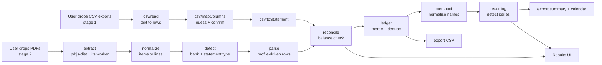

# Architecture

**Date:** 2026-11-10 · **Status:** Proposed; input order changed by ADR-018 (CSV first, PDF second) · Decisions are recorded in `docs/DECISIONS.md`; evidence is in `docs/RESEARCH.md`.

## 1. Shape of the system

A static single-page web app. There is no backend, no database, no API and no account system. This is deliberate: the product's core promise is that statement data never leaves the device, and the cheapest way to keep that promise is to have nowhere to send it (ADR-001).

There are two inputs, built in this order (ADR-018). Both produce the same `ParsedStatement`, so everything from `reconcile` onward is shared.



Everything except `extract` and the UI is pure TypeScript with no browser dependencies. That is the property that makes the project testable: the same functions run in Vitest on Node against JSON fixtures, with no PDF and no browser involved.

## 2. Design principles

1. **Correct or loudly unsure.** Every statement gets a reconciliation status. Unverified numbers are never shown as if they were verified.
2. **Pure core, thin edges.** Only one module touches `pdfjs-dist`; only the UI touches the DOM.
3. **Banks are data, not code.** A new format is a profile object plus fixtures.
4. **Reuse the proven parts** (PDF parsing, build, tests, hosting) and spend effort only on what does not exist (row reconstruction, Canadian profiles, recurrence detection).
5. **No real financial data in the repository, in CI, or in an AI assistant's context.**

## 3. Technology stack

| Layer                  | Choice                                      | Why                                                                                                            |
| ---------------------- | ------------------------------------------- | -------------------------------------------------------------------------------------------------------------- |
| Language               | TypeScript 7.0.x, strict mode               | Money and date handling benefit from strong types; fallback to 6.0.x if a tool requires it                     |
| UI                     | React 19.3                                  | Bruce already knows it; recruiters recognise it; framework size is irrelevant next to the 1.3 MB pdf.js worker |
| Build                  | Vite 8.3                                    | Standard, fast, first-class worker and static-asset handling                                                   |
| Styling                | Tailwind CSS 4.3                            | Fast to build a small UI; no runtime                                                                           |
| PDF                    | `pdfjs-dist` 6.5.438                        | Positioned text plus metadata; Mozilla-maintained                                                              |
| CSV                    | PapaParse 5.7                               | Correct RFC 4180 quoting without hand-rolling it                                                               |
| Unit and fixture tests | Vitest 5.1                                  | Shares Vite's config                                                                                           |
| Property tests         | fast-check 4.10                             | Parsers and detectors have natural invariants                                                                  |
| End-to-end             | Playwright 1.65                             | Real browser, real pdf.js, network assertions                                                                  |
| Lint and format        | Biome 2.6                                   | Works with TypeScript 7; one tool instead of two                                                               |
| Runtime for tooling    | Node 24 LTS, npm                            | No extra package manager to install                                                                            |
| Hosting                | Cloudflare Pages (GitHub Pages as fallback) | Free; supports real CSP response headers                                                                       |

There are four runtime dependencies: `react`, `react-dom`, `pdfjs-dist` and `papaparse`. Tailwind is build-time only. Keep the runtime count under ten (NFR-7).

## 4. Repository layout

```
src/
  core/                 # pure TypeScript — no DOM, no pdfjs imports
    types.ts            # domain types (§5)
    money.ts            # cents parsing and formatting
    plainDate.ts        # YYYY-MM-DD helpers, day differences
    csv/                # stage 1: read.ts, mapColumns.ts, toStatement.ts
    normalize/          # stage 2: RawDocument -> LineDocument
    profiles/           # stage 2: one file per PDF format + registry
    detect.ts           # stage 2: choose a profile
    parse/              # stage 2: profile-driven row extraction
    reconcile.ts        # balance verification
    ledger.ts           # merge, dedupe, continuity checks
    merchant/           # description -> merchant key (+ alias table)
    recurring/          # series detection, price changes, confidence
    exportCsv.ts        # ledger and recurring list as CSV
    exportIcs.ts        # renewal dates as a calendar file
  pdf/
    extract.ts          # stage 2: the ONLY module importing pdfjs-dist
  ui/                   # React components and state
  demo/                 # synthetic sample files (generated)
fixtures/
  <bank>/<kind>/<name>/ # input.csv or input.json (redacted), expected.json
  synthetic/            # generated CSVs and PDFs for end-to-end tests
tools/
  fixture-dump.ts       # local CLI: real CSV or PDF -> redacted fixture
  make-synthetic.ts     # generates synthetic exports and statements
e2e/                    # Playwright tests
private/                # owner's deny-list for the fixture check — gitignored, denied to AI tools
                        # real statements live in ~/Statements/, outside the repo (ADR-016)
docs/
```

A Biome or simple import-lint rule enforces that nothing under `src/core/` imports from `src/pdf/`, `src/ui/`, or `pdfjs-dist`.

## 5. Data model

```ts
type Cents = number; // integer; never store dollars as floats
type PlainDate = string; // "YYYY-MM-DD"; no time zones anywhere

interface RawItem {
  str: string;
  x: number;
  y: number;
  w: number;
  h: number;
  font: string;
}
interface RawPage {
  width: number;
  height: number;
  items: RawItem[];
}
interface RawDocument {
  meta: { producer?: string; creator?: string; title?: string };
  pages: RawPage[];
}

interface Line {
  page: number;
  y: number;
  items: RawItem[];
  text: string;
}
interface LineDocument {
  meta: RawDocument["meta"];
  lines: Line[];
}

type AccountKind = "deposit" | "credit";

// Which CSV column holds what. Indexes, because some exports have no header row.
interface ColumnMapping {
  hasHeader: boolean;
  date: number;
  dateFormat: "YYYY-MM-DD" | "MM/DD/YYYY" | "DD/MM/YYYY";
  description: number;
  amount: { signed: number } | { debit: number; credit: number };
  balance?: number;
  confidence: "high" | "low"; // low = ask the user to confirm
}

interface Transaction {
  id: string; // stable hash of statement + row position
  date: PlainDate;
  postedDate?: PlainDate;
  description: string; // as printed, whitespace-collapsed
  amount: Cents; // signed: negative = money out
  balanceAfter?: Cents;
  source:
    | { statementId: string; input: "csv"; row: number }
    | { statementId: string; input: "pdf"; page: number; lineIndex: number };
}

interface ParsedStatement {
  id: string;
  input: "csv" | "pdf";
  bankId: string; // "unknown" for a CSV the app could not attribute
  kind: AccountKind;
  period: { start: PlainDate; end: PlainDate };
  openingBalance?: Cents;
  closingBalance?: Cents;
  transactions: Transaction[];
  warnings: string[];
}

type Reconciliation =
  | { status: "verified"; method: "totals" | "running-balance" }
  | { status: "mismatch"; expected: Cents; actual: Cents; firstBadRow?: number }
  | { status: "unverifiable"; reason: string };

interface RecurringSeries {
  merchantKey: string;
  displayName: string;
  cadence:
    | "weekly"
    | "biweekly"
    | "monthly"
    | "quarterly"
    | "annual" // two charges about a year apart
    | "annual-possible"; // one large charge; not enough history
  ambiguous: boolean; // description names only an app store or processor
  typicalAmount: Cents;
  amountKind: "fixed" | "variable";
  monthlyEquivalent: Cents;
  occurrences: Transaction[];
  nextExpected: PlainDate;
  priceChange?: { from: Cents; to: Cents; since: PlainDate };
  confidence: "high" | "medium" | "low";
}
```

Every transaction keeps a pointer to its source page and line so the UI can show where a number came from and so bug reports are precise.

## 6. Pipeline stages

Each stage is a function with one input type and one output type.

### 6.0 CSV input (stage 1)

- **`csv/read`** — `string → { ok: true, rows: string[][] } | { ok: false, reason }`; a malformed quote fails closed. Rows may differ in width and the delimiter is auto-detected, so `mapColumns` must check that rows have consistent width. PapaParse does the parsing. Strips a byte-order mark and trailing blank rows.
- **`csv/mapColumns`** — `string[][] → ColumnMapping`. Looks at header labels when there are any, and at the cell contents otherwise: a column where nearly every cell parses as a date is the date; a column of money values that continues from row to row by the amount is the balance. When two readings are plausible (for example day-first against month-first dates) the confidence is `low` and the UI asks the user. The function never picks silently.
- **`csv/toStatement`** — `(string[][], ColumnMapping) → ParsedStatement`. Converts amounts to cents and dates to `PlainDate`; rows that fail to convert become warnings, never guessed values.

Real export layouts are facts to learn from the owner's redacted fixtures in M1. Nothing about a bank's layout is assumed in code before a fixture shows it.

### 6.1 `extract` (edge, stage 2)

`ArrayBuffer → RawDocument`. Calls `getDocument`, `getMetadata`, and `getTextContent` for each page; converts each item's transform into top-left-origin `x`, `y`; drops empty strings. `pdfjs-dist` runs its parsing in its own worker, loaded from the same origin. The worker bundle is fetched only when the first file is dropped.

### 6.2 `normalize`

`RawDocument → LineDocument`. Groups items into lines using a tolerance relative to font height, sorts left to right, and merges adjacent fragments whose gap is smaller than a space. Handles statements where each glyph is its own item.

### 6.3 `detect`

`LineDocument → BankProfile | null`. Each profile declares identifiers: PDF metadata values and text markers. The first profile whose identifiers all match wins. No match means FR-2's "unsupported format" path.

### 6.4 `parse`

`(LineDocument, BankProfile) → ParsedStatement`.

- **Header-anchored columns.** Find the header row by its labels, then derive each column's x-range from the label positions on that page. Nothing is a hard-coded coordinate, so small layout shifts do not break parsing.
- **Right-edge matching for amounts.** Amount columns are right-aligned, so a number belongs to the column whose right edge is nearest (validated in the spike).
- **Row assembly.** A line with an amount starts a transaction. A line without one, positioned in the description column, continues the previous description. A missing date inherits the previous row's date.
- **Year inference.** Statements print "Oct 15", not a year. The year comes from the statement period, with December–January rollover handled explicitly.
- **Sign convention** comes from the profile (separate withdrawal and deposit columns, a trailing minus, or a `CR` marker).

### 6.5 `reconcile`

`ParsedStatement → Reconciliation`. Arithmetic is in integer cents. The profile chooses the method:

- **`running-balance`** — every row's printed balance must equal the previous balance plus the row's amount. Pinpoints the first bad row.
- **`totals`** — opening balance plus the sum of transactions must equal the closing balance.
- If neither is available the result is `unverifiable`, never `verified`. A CSV with a balance column uses `running-balance`; a CSV without one is `unverifiable`.

Statements are also chained: the closing balance of one must equal the opening balance of the next, which detects a missing month.

### 6.6 `ledger`

Merges statements, sorts by date, removes duplicates from overlapping periods using date, amount, description and running balance, and reports gaps.

### 6.7 `merchant`

`description → merchantKey`. Upper-case; strip store numbers, phone numbers, city and province suffixes, reference codes and payment-processor prefixes; collapse whitespace; then apply a small alias table for common billers. The rules are tested against a hand-written list of realistic descriptors, not against anyone's real spending.

### 6.8 `recurring`

`Transaction[] → RecurringSeries[]`. Version 1 is a transparent heuristic, not a model:

1. Consider money-out transactions; drop transfers and card payments by keyword.
2. Group by `merchantKey`. Require three or more occurrences (two gives a low-confidence "possible").
3. Compute gaps in days between consecutive occurrences. Map the median gap to a cadence bucket: weekly 7 ± 1, bi-weekly 14 ± 2, monthly 28–33, quarterly 85–95.
4. Score interval consistency (share of gaps inside the bucket) and amount stability (share of amounts within 7.5% or $1 of the median, the tolerance Actual Budget uses).
5. A sustained step in the amount becomes a `priceChange`.
6. Combine occurrence count, interval consistency and amount stability into high, medium or low confidence. Stable cadence with varying amounts is labelled a variable recurring bill.
7. Annual: two charges from one merchant 350–380 days apart with a stable amount are an `annual` series. One large charge with no repeat stays `annual-possible`. When the history is shorter than 13 months the result says so.
8. A series whose description names only an app store or a payment processor is marked `ambiguous`, because several services can hide behind one descriptor.

### 6.9 `exportIcs`

`RecurringSeries[] → string`. One all-day event per series on its `nextExpected` date, with the name and typical amount. Written by hand against RFC 5545 (text escaping, line folding, CRLF); no dependency.

Every series carries its evidence rows, so the user can see why something was flagged.

## 7. User interface

One page, five states: **empty** (drop zone, "Try with sample data", "How to download your transactions", how-it-works), **confirm columns** (only when a mapping has low confidence), **processing**, **results**, **error**.

Results has three views:

- **Subscriptions** — the recurring series, sorted by annual cost, each expandable to its evidence; the yearly total; "Download list" and "Add renewals to calendar".
- **Transactions** — the ledger table with search and "Download CSV".
- **Files** — one row per file with bank (when known), period and verification status.

State lives in memory only. Closing or reloading the tab discards everything (ADR-010). A permanent footer links to "How to verify nothing is uploaded": open the browser's network tab, or load the page, turn off Wi-Fi, then drop a file.

## 8. Security and privacy

**Threat model**

| Threat                                                   | Mitigation                                                                                                                                                                                                 |
| -------------------------------------------------------- | ---------------------------------------------------------------------------------------------------------------------------------------------------------------------------------------------------------- |
| App or a dependency sends statement data somewhere       | No network code in the app; CSP restricts connections to the app's own origin, which is a static file host with no upload endpoint; end-to-end test asserts no cross-origin requests and no request bodies |
| Malicious or compromised dependency                      | Four runtime dependencies, exact pins, lockfile, `npm ci` in CI; no post-MVP dependency added without a research note                                                                                      |
| Malicious CSV                                            | Parsed as data only; cells are never evaluated; all text is inserted through React (escaped); exported text fields are sanitised against formula injection                                                 |
| Malicious PDF                                            | Parsed by pdf.js in a worker; we render nothing from the PDF, only read text; all text is inserted through React (escaped), never as HTML                                                                  |
| CSV formula injection when the export is opened in Excel | Text fields beginning with `=`, `+`, `-`, `@`, tab or carriage return are prefixed with `'`; numeric fields are left alone                                                                                 |
| Real statements leaking into Git or CI                   | `private/` is gitignored; a CI check fails on any PDF outside `fixtures/synthetic/` and on long digit runs in fixtures                                                                                     |
| Real statements leaking to an AI coding assistant        | Statements live outside the repository; Claude Code deny rules, an OS-level sandbox read block and a guard hook that also covers MCP tools (ADR-015, ADR-016); development uses redacted fixtures only     |
| Clickjacking                                             | `frame-ancestors 'none'` response header on Cloudflare Pages                                                                                                                                               |

**Content Security Policy** (sent as a response header via `_headers`, and duplicated in a `<meta>` tag so the policy survives a move to a host without header support):

```
default-src 'none';
script-src 'self';
worker-src 'self';
style-src 'self';
img-src 'self' data:;
font-src 'self';
connect-src 'self';
base-uri 'none';
form-action 'none';
frame-ancestors 'none'
```

`connect-src 'self'` is needed because pdf.js may fetch character-map files from the app's own origin. If M5 shows text extraction works without them, tighten it to `'none'`. If pdf.js turns out to need WebAssembly for these statements, add `'wasm-unsafe-eval'` to `script-src` and record why.

**Fixture redaction.** `tools/fixture-dump.ts` runs locally, extracts positioned text, keeps dates, amounts and structural labels, replaces each distinct description with a stable placeholder (`MERCHANT_07`), and masks other digit runs. Stable placeholders preserve recurrence patterns, so redacted fixtures still exercise the detector. A human reviews the output before committing.

## 9. Performance

- Budget: 12 statements in under 5 seconds (AC-9); no main-thread task over 200 ms.
- PDF parsing, the expensive part, is already off the main thread inside pdf.js.
- Our pipeline is linear in the number of text items. If profiling ever shows a long task with large batches, move stages 6.2–6.8 into a dedicated worker; they are pure functions, so this is mechanical (ADR-008).
- The pdf.js library and worker are loaded on first use, not on page load.

## 10. Testing strategy

| Level              | What                                                                                                                                                                                  | Tool       |
| ------------------ | ------------------------------------------------------------------------------------------------------------------------------------------------------------------------------------- | ---------- |
| Unit               | `money`, `plainDate`, CSV reading and column mapping (each synthetic layout), merchant rules, cadence bucketing, CSV sanitiser, calendar file round trip                              | Vitest     |
| Golden fixtures    | `input.json` → exact `expected.json`, and reconciliation must be `verified`                                                                                                           | Vitest     |
| Mutation           | Remove or alter one row in each fixture → must become `mismatch`                                                                                                                      | Vitest     |
| Property           | Generate random ledgers → render to a synthetic `LineDocument` → parse → must equal the original; detector invariants (order-independence, no series from fewer than two occurrences) | fast-check |
| Labelled scenarios | ≥ 30 synthetic ledgers with known subscriptions → precision and recall report (AC-6)                                                                                                  | Vitest     |
| End-to-end         | Synthetic PDFs through the real UI in Chromium, Firefox and WebKit; network assertions; offline run; timing                                                                           | Playwright |
| Accessibility      | Automated axe scan on each UI state                                                                                                                                                   | Playwright |

Coverage target: 90% of lines in `src/core/`. No coverage target for `src/ui/`; it is covered by end-to-end tests.

## 11. Deployment

`main` → GitHub Actions (typecheck, lint, unit, fixtures, build, end-to-end) → Cloudflare Pages serves the built `dist/` folder. The exact deploy mechanism (Cloudflare's Git integration or an upload step from CI) is chosen in M4. No secrets are needed at runtime because there is no runtime server.

## 12. Extensibility, scale and cost

- **Adding a bank:** write a profile, add three or more redacted fixtures, add a row to the supported-formats table. No pipeline changes (NFR-6).
- **Scale:** each user's browser does its own work. Traffic growth only increases static-file requests.
- **Cost:** $0 on the free hosting tier. An optional custom domain would be the only expense.

## 13. Revisit when

- Real statements defeat the geometry approach on some bank → consider reconstructing layout text and matching patterns for that profile only.
- Batches above roughly 50 statements cause jank → dedicated worker.
- Users ask to keep data between visits → opt-in local storage, with a clear "stored on this device" notice.
- Column guessing proves unreliable for some bank's export → add a small per-bank CSV preset (data, not code), chosen by the user or by header match.
